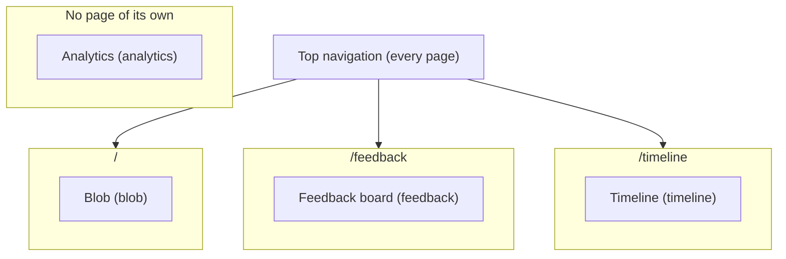

# Feature map

<!-- Generated by `pnpm featuremap` from each src/features/*/feature.manifest.ts. Don't edit it by hand: CI fails when it's out of date. -->

Read this before any task. It maps what's on screen to a feature folder, its `data-testid` selectors and the flows that `pnpm verify:flow <feature>.<flow>` runs.

## Features

| Feature | Routes | Where it is on screen | How to reach it | Selectors (`data-testid`) | Flows | Risk |
|---|---|---|---|---|---|---|
| [Analytics (`analytics`)](#analytics-analytics) | none | Invisible. Each page renders a PageView tracker, and features call shared/lib/track on interactions. Events are POSTed to /api/events. | Open any page; a 'view' event is sent once per page show | none | none | medium |
| [Blob (`blob`)](#blob-blob) | `/` | The home page is two columns on a wide screen and stacked on a narrow one. The left column has the creature, a rainbow 'Evolved N times from visitor ideas' link to the Timeline, playful Size / Mood / Pokes / Snacks stats (Mood reads Sleepy, with eyes shut, from 22:00 to 06:00 local time, and Awake otherwise), a pink Poke button, a green Feed button, colour swatches, and a rename field. The right column is the timeline diary card, with a tan Teach Blobby bar and a Suggest a lesson link underneath. | Open / (from another page, click 'Blob' in the top navigation) | `blob-panel`, `blob-name`, `blob-creature`, `blob-body`, `blob-eyelid`, `blob-mood`, `blob-size`, `blob-pokes`, `blob-feeds`, `blob-evolved`, `blob-poke-button`, `blob-feed-button`, `blob-color-picker`, `blob-color-swatch-pink`, `blob-name-input`, `blob-name-save`, `blob-name-error`, `blob-teach` | `blob.poke`, `blob.feed`, `blob.blink`, `blob.sleepy`, `blob.awake`, `blob.recolor`, `blob.evolved`, `blob.rename` | low |
| [Feedback board (`feedback`)](#feedback-board-feedback) | `/feedback` | The /feedback page, in a centred column: a small blotchy blob beside the 'Teach Blobby' heading and a note that the most-voted ideas are taught by agents and may show up on the Timeline, then a soft card with the post form (textarea, Idea/Bug radios, character counter, purple Suggest a lesson button; a paused-lessons note instead while the feedback_open flag is off or the app is read-only), then the board headed 'What to teach Blobby' with Top / Newest sort tabs on the right and one soft card per item (votes on the left, text, a mini blob with 'Blobby learned this' when shipped, a gentle reason when rejected, category, pastel status badge, relative age such as 3 days ago, issue/PR links, and a small 'Report' link at the right end of that row, which asks 'Confirm report' before it counts). | Open / → Click 'Feedback' in the top navigation (the middle one of the three links on the right) | `feedback-panel`, `feedback-heading`, `feedback-list`, `feedback-empty`, `feedback-item`, `feedback-item-body`, `feedback-item-age`, `feedback-item-status`, `feedback-learned`, `feedback-rejection`, `feedback-item-issue-link`, `feedback-item-pr-link`, `feedback-vote-button`, `feedback-vote-count`, `feedback-vote-error`, `feedback-vote-note`, `feedback-report-button`, `feedback-report-cancel`, `feedback-report-note`, `feedback-report-error`, `feedback-form`, `feedback-body-input`, `feedback-category-idea`, `feedback-category-bug`, `feedback-char-count`, `feedback-submit`, `feedback-form-message`, `feedback-closed-note`, `feedback-sort-top`, `feedback-sort-new` | `feedback.browse`, `feedback.post`, `feedback.age`, `feedback.vote`, `feedback.report` | medium |
| [Timeline (`timeline`)](#timeline-timeline) | `/timeline` | On the home page, the right-hand card (under the creature on a narrow screen) is titled 'Blobby's changes' and shows the newest rows with before/after art. The /timeline page repeats that diary in full: the same heading, an 'Evolved N times from visitor ideas' counter, then one card per change (title, before/after pictures, the visitor quote, then a collapsed 'More about this change'). When a change has no screenshot, the picture is a drawn Blobby. Reverts have a red 'Reverted' badge and the line 'This undid a change that hurt Blobby.' | Open / → Click 'Timeline' in the top navigation (the last of the three links on the right) | `timeline-panel`, `timeline-heading`, `timeline-counter`, `timeline-list`, `timeline-empty`, `timeline-entry`, `timeline-entry-title`, `timeline-revert-badge`, `timeline-revert-note`, `timeline-art`, `timeline-pr-link`, `timeline-home`, `timeline-home-heading` | `timeline.browse`, `timeline.home` | medium |

## Page layout

## Analytics (`analytics`)

Records anonymous page views and feature interactions (feature id + action + path, no personal data) so triage can see what people use.

- **Folder:** `src/features/analytics/`
- **Routes:** none (it has no page of its own)
- **Where it is on screen:** Invisible. Each page renders a PageView tracker, and features call shared/lib/track on interactions. Events are POSTed to /api/events.
- **Keyboard shortcuts:** none
- **Data tables:** `events`
- **Risk level:** medium

How to reach it:

1. Open any page; a 'view' event is sent once per page show

No selectors.

No flows.

## Blob (`blob`)

A squishy SVG creature you can poke, feed and name. Play stays in the visitor's browser. Under the face, a link counts how many Timeline changes are still in effect.

- **Folder:** `src/features/blob/`
- **Routes:** `/`
- **Where it is on screen:** The home page is two columns on a wide screen and stacked on a narrow one. The left column has the creature, a rainbow 'Evolved N times from visitor ideas' link to the Timeline, playful Size / Mood / Pokes / Snacks stats (Mood reads Sleepy, with eyes shut, from 22:00 to 06:00 local time, and Awake otherwise), a pink Poke button, a green Feed button, colour swatches, and a rename field. The right column is the timeline diary card, with a tan Teach Blobby bar and a Suggest a lesson link underneath.
- **Keyboard shortcuts:** none
- **Data tables:** none
- **Risk level:** low

How to reach it:

1. Open / (from another page, click 'Blob' in the top navigation)

| Selector | `data-testid` |
|---|---|
| panel | `blob-panel` |
| name | `blob-name` |
| creature | `blob-creature` |
| body | `blob-body` |
| eyelid | `blob-eyelid` |
| mood | `blob-mood` |
| size | `blob-size` |
| pokes | `blob-pokes` |
| feeds | `blob-feeds` |
| evolved | `blob-evolved` |
| pokeButton | `blob-poke-button` |
| feedButton | `blob-feed-button` |
| colorPicker | `blob-color-picker` |
| colorPink | `blob-color-swatch-pink` |
| nameInput | `blob-name-input` |
| nameSave | `blob-name-save` |
| nameError | `blob-name-error` |
| teach | `blob-teach` |

### `blob.poke`

Poking the blob makes it wobble and counts the poke. Run it with `pnpm verify:flow blob.poke`.

1. goto `/`
2. expectVisible `creature`
3. screenshot "before-poke"
4. click `pokeButton`
5. expectText `pokes` contains "1"
6. screenshot "after-poke"

### `blob.feed`

Feeding the blob grows it by 5%. Run it with `pnpm verify:flow blob.feed`.

1. goto `/`
2. expectText `size` contains "100%"
3. click `feedButton`
4. expectText `size` contains "105%"
5. screenshot "after-feed"

### `blob.blink`

In the daytime the blob blinks every few seconds, and poking and feeding still work. Run it with `pnpm verify:flow blob.blink`.

1. goto `/?hour=12`
2. expectVisible `creature`
3. pauseAnimations at 1000 ms
4. expectStyle `eyelid` has visibility "hidden"
5. screenshot "eyes-open"
6. pauseAnimations at 3350 ms
7. expectStyle `eyelid` has visibility "visible"
8. screenshot "eyes-closed"
9. click `pokeButton`
10. expectText `pokes` contains "1"
11. click `feedButton`
12. expectText `size` contains "105%"

### `blob.sleepy`

Between 22:00 and 06:00 local time (pinned here with ?hour=23) Blobby's eyes stay shut and the mood reads Sleepy, and poking and feeding still work. Run it with `pnpm verify:flow blob.sleepy`.

1. goto `/?hour=23`
2. expectVisible `creature`
3. expectVisible `mood`
4. expectText `mood` contains "Sleepy"
5. pauseAnimations at 1000 ms
6. expectStyle `eyelid` has visibility "visible"
7. screenshot "sleepy-night"
8. click `pokeButton`
9. expectText `pokes` contains "1"
10. click `feedButton`
11. expectText `size` contains "105%"
12. screenshot "sleepy-after-play"

### `blob.awake`

In the daytime (pinned here with ?hour=12) Blobby keeps its open-eyed face and the mood reads Awake, not Sleepy. Run it with `pnpm verify:flow blob.awake`.

1. goto `/?hour=12`
2. expectVisible `creature`
3. expectVisible `mood`
4. expectText `mood` contains "Awake"
5. pauseAnimations at 1000 ms
6. expectStyle `eyelid` has visibility "hidden"
7. screenshot "awake-day"

### `blob.recolor`

Picking a colour swatch changes the blob's body colour, it survives a reload, and poke and feed still work. Run it with `pnpm verify:flow blob.recolor`.

1. goto `/`
2. expectVisible `colorPicker`
3. screenshot "before-colour"
4. click `colorPink`
5. expectStyle `body` has fill "rgb(232, 111, 163)"
6. screenshot "after-colour"
7. goto `/`
8. expectStyle `body` has fill "rgb(232, 111, 163)"
9. click `pokeButton`
10. expectText `pokes` contains "1"
11. click `feedButton`
12. expectText `size` contains "105%"
13. screenshot "after-reload"

### `blob.evolved`

The line under the face counts shipped Timeline changes and opens the diary. A Teach Blobby bar offers a lesson. Run it with `pnpm verify:flow blob.evolved`.

1. goto `/`
2. expectVisible `creature`
3. expectText `evolved` contains "Evolved"
4. expectText `evolved` contains "from visitor ideas"
5. expectVisible `teach`
6. expectText `teach` contains "Suggest a lesson"
7. screenshot "evolved"

### `blob.rename`

Renaming the blob updates its heading. Run it with `pnpm verify:flow blob.rename`.

1. goto `/`
2. fill `nameInput` with "Gloop"
3. click `nameSave`
4. expectText `name` contains "Gloop"
5. screenshot "after-rename"

## Feedback board (`feedback`)

Anonymous visitors teach Blobby an idea or a bug (max 280 characters), upvote others, report abuse and follow each item's status, sorted by top votes or newest. A shipped idea shows a mini blob and 'Blobby learned this'. A rejected idea shows one gentle reason. Reports from 3 different networks hide an item.

- **Folder:** `src/features/feedback/`
- **Routes:** `/feedback`
- **Where it is on screen:** The /feedback page, in a centred column: a small blotchy blob beside the 'Teach Blobby' heading and a note that the most-voted ideas are taught by agents and may show up on the Timeline, then a soft card with the post form (textarea, Idea/Bug radios, character counter, purple Suggest a lesson button; a paused-lessons note instead while the feedback_open flag is off or the app is read-only), then the board headed 'What to teach Blobby' with Top / Newest sort tabs on the right and one soft card per item (votes on the left, text, a mini blob with 'Blobby learned this' when shipped, a gentle reason when rejected, category, pastel status badge, relative age such as 3 days ago, issue/PR links, and a small 'Report' link at the right end of that row, which asks 'Confirm report' before it counts).
- **Keyboard shortcuts:** none
- **Data tables:** `feedback`, `votes`, `feedback_reports`, `rate_limit_hits`
- **Risk level:** medium

How to reach it:

1. Open /
2. Click 'Feedback' in the top navigation (the middle one of the three links on the right)

| Selector | `data-testid` |
|---|---|
| panel | `feedback-panel` |
| heading | `feedback-heading` |
| list | `feedback-list` |
| empty | `feedback-empty` |
| item | `feedback-item` |
| itemBody | `feedback-item-body` |
| itemAge | `feedback-item-age` |
| itemStatus | `feedback-item-status` |
| learned | `feedback-learned` |
| rejection | `feedback-rejection` |
| itemIssueLink | `feedback-item-issue-link` |
| itemPrLink | `feedback-item-pr-link` |
| voteButton | `feedback-vote-button` |
| voteCount | `feedback-vote-count` |
| voteError | `feedback-vote-error` |
| voteNote | `feedback-vote-note` |
| reportButton | `feedback-report-button` |
| reportCancel | `feedback-report-cancel` |
| reportNote | `feedback-report-note` |
| reportError | `feedback-report-error` |
| form | `feedback-form` |
| bodyInput | `feedback-body-input` |
| categoryIdea | `feedback-category-idea` |
| categoryBug | `feedback-category-bug` |
| charCount | `feedback-char-count` |
| submit | `feedback-submit` |
| formMessage | `feedback-form-message` |
| closedNote | `feedback-closed-note` |
| sortTop | `feedback-sort-top` |
| sortNew | `feedback-sort-new` |

### `feedback.browse`

The board lists feedback and switches between Top and Newest. Run it with `pnpm verify:flow feedback.browse`.

1. goto `/feedback`
2. expectText `heading` contains "Teach Blobby"
3. expectVisible `item`
4. expectText `learned` contains "Blobby learned this"
5. expectText `rejection` contains "too big for one lesson"
6. screenshot "board-top"
7. click `sortNew`
8. expectVisible `item`
9. screenshot "board-newest"

### `feedback.post`

Posting an idea shows a confirmation and puts it on the board. Run it with `pnpm verify:flow feedback.post`. It writes data, so `verify:all --read-only` (production) skips it.

1. goto `/feedback?sort=new`
2. fill `bodyInput` with "Verification flow: give the blob a tiny hat"
3. click `categoryIdea`
4. click `submit`
5. expectText `formMessage` contains "Thanks! Blobby can see it on the board."
6. expectText `list` contains "Verification flow: give the blob a tiny hat"
7. screenshot "after-post"

### `feedback.age`

Each feedback card shows how long ago it was posted; a new post reads 'just now'. Run it with `pnpm verify:flow feedback.age`. It writes data, so `verify:all --read-only` (production) skips it.

1. goto `/feedback?sort=new`
2. expectVisible `item`
3. expectVisible `itemAge`
4. fill `bodyInput` with "Age label check"
5. click `categoryIdea`
6. click `submit`
7. expectText `list` contains "Age label check"
8. expectText `itemAge` contains "just now"
9. screenshot "age-labels"

### `feedback.vote`

Upvoting an item marks the button as voted. Run it with `pnpm verify:flow feedback.vote`. It writes data, so `verify:all --read-only` (production) skips it.

1. goto `/feedback?sort=new`
2. click `voteButton`
3. expectVisible `voteCount`
4. screenshot "after-vote"

### `feedback.report`

Reporting the flow's own new post asks for a confirmation, then thanks the reporter; the item stays on the board until 3 networks report it. Run it with `pnpm verify:flow feedback.report`. It writes data, so `verify:all --read-only` (production) skips it.

1. goto `/feedback?sort=new`
2. fill `bodyInput` with "Verification flow: report this post"
3. click `categoryIdea`
4. click `submit`
5. expectText `list` contains "Verification flow: report this post"
6. click `reportButton`
7. expectText `reportButton` contains "Confirm report"
8. expectVisible `reportCancel`
9. screenshot "report-confirm"
10. click `reportButton`
11. expectText `reportNote` contains "Reported. Thanks."
12. expectText `list` contains "Verification flow: report this post"
13. screenshot "after-report"

## Timeline (`timeline`)

Blobby's diary: every shipped change and revert, newest first, with a before/after picture for each. The home page shows the newest three beside the creature. The pull request, commit and trust level sit under More about this change.

- **Folder:** `src/features/timeline/`
- **Routes:** `/timeline`
- **Where it is on screen:** On the home page, the right-hand card (under the creature on a narrow screen) is titled 'Blobby's changes' and shows the newest rows with before/after art. The /timeline page repeats that diary in full: the same heading, an 'Evolved N times from visitor ideas' counter, then one card per change (title, before/after pictures, the visitor quote, then a collapsed 'More about this change'). When a change has no screenshot, the picture is a drawn Blobby. Reverts have a red 'Reverted' badge and the line 'This undid a change that hurt Blobby.'
- **Keyboard shortcuts:** none
- **Data tables:** `changelog`, `feedback`
- **Risk level:** medium

How to reach it:

1. Open /
2. Click 'Timeline' in the top navigation (the last of the three links on the right)

| Selector | `data-testid` |
|---|---|
| panel | `timeline-panel` |
| heading | `timeline-heading` |
| counter | `timeline-counter` |
| list | `timeline-list` |
| empty | `timeline-empty` |
| entry | `timeline-entry` |
| entryTitle | `timeline-entry-title` |
| revertBadge | `timeline-revert-badge` |
| revertNote | `timeline-revert-note` |
| art | `timeline-art` |
| prLink | `timeline-pr-link` |
| home | `timeline-home` |
| homeHeading | `timeline-home-heading` |

### `timeline.browse`

The timeline shows the counter and the newest entries. Run it with `pnpm verify:flow timeline.browse`.

1. goto `/timeline`
2. expectText `heading` contains "Blobby's changes"
3. expectText `counter` contains "from visitor ideas"
4. expectVisible `entry`
5. expectVisible `art`
6. screenshot "timeline"

### `timeline.home`

The home page shows recent changes as diary art beside the creature. Run it with `pnpm verify:flow timeline.home`.

1. goto `/`
2. expectVisible `home`
3. expectText `homeHeading` contains "Blobby's changes"
4. expectVisible `art`
5. screenshot "home-diary"
