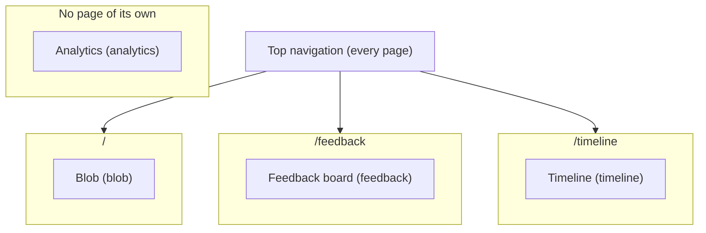

# Feature map

<!-- Generated by `pnpm featuremap` from each src/features/*/feature.manifest.ts. Don't edit it by hand: CI fails when it's out of date. -->

Read this before any task. It maps what's on screen to a feature folder, its `data-testid` selectors and the flows that `pnpm verify:flow <feature>.<flow>` runs.

## Features

| Feature | Routes | Where it is on screen | How to reach it | Selectors (`data-testid`) | Flows | Risk |
|---|---|---|---|---|---|---|
| [Analytics (`analytics`)](#analytics-analytics) | none | Invisible. Each page renders a PageView tracker, and features call shared/lib/track on interactions. Events are POSTed to /api/events. | Open any page; a 'view' event is sent once per page show | none | none | medium |
| [Blob (`blob`)](#blob-blob) | `/` | The home page, centred under the top navigation: the blob's name, the creature, its stats, Poke and Feed buttons, and a rename form. | Open / (from another page, click 'Blob' in the top navigation) | `blob-panel`, `blob-name`, `blob-creature`, `blob-body`, `blob-eyelid`, `blob-size`, `blob-pokes`, `blob-feeds`, `blob-poke-button`, `blob-feed-button`, `blob-name-input`, `blob-name-save`, `blob-name-error` | `blob.poke`, `blob.feed`, `blob.blink`, `blob.rename` | low |
| [Feedback board (`feedback`)](#feedback-board-feedback) | `/feedback` | The /feedback page: heading at the top, then a post form (textarea, Idea/Bug radios, character counter, Post button), then the board with Top / Newest sort tabs on the right and one card per item (votes on the left, text, category, status badge, relative age such as 3 days ago, and issue/PR links). | Open / → Click 'Feedback' in the top navigation (the middle one of the three links on the right) | `feedback-panel`, `feedback-heading`, `feedback-list`, `feedback-empty`, `feedback-item`, `feedback-item-body`, `feedback-item-age`, `feedback-item-status`, `feedback-item-issue-link`, `feedback-item-pr-link`, `feedback-vote-button`, `feedback-vote-count`, `feedback-vote-error`, `feedback-form`, `feedback-body-input`, `feedback-category-idea`, `feedback-category-bug`, `feedback-char-count`, `feedback-submit`, `feedback-form-message`, `feedback-sort-top`, `feedback-sort-new` | `feedback.browse`, `feedback.post`, `feedback.age`, `feedback.vote` | medium |
| [Timeline (`timeline`)](#timeline-timeline) | `/timeline` | The /timeline page: a heading, a 'N changes shipped, 0 written by humans' counter, then a vertical list of change cards. Reverts have a red 'Reverted' badge. | Open / → Click 'Timeline' in the top navigation (the last of the three links on the right) | `timeline-panel`, `timeline-heading`, `timeline-counter`, `timeline-list`, `timeline-empty`, `timeline-entry`, `timeline-entry-title`, `timeline-revert-badge`, `timeline-pr-link` | `timeline.browse` | medium |

## Page layout

## Analytics (`analytics`)

Records anonymous page views and feature interactions (feature id + action + path, no personal data) so triage can see what people use.

- **Folder:** `src/features/analytics/`
- **Routes:** none (it has no page of its own)
- **Where it is on screen:** Invisible. Each page renders a PageView tracker, and features call shared/lib/track on interactions. Events are POSTed to /api/events.
- **Keyboard shortcuts:** none
- **Data tables:** `events`
- **Risk level:** medium

How to reach it:

1. Open any page; a 'view' event is sent once per page show

No selectors.

No flows.

## Blob (`blob`)

A squishy SVG creature you can poke, feed and name. State lives in the visitor's browser only.

- **Folder:** `src/features/blob/`
- **Routes:** `/`
- **Where it is on screen:** The home page, centred under the top navigation: the blob's name, the creature, its stats, Poke and Feed buttons, and a rename form.
- **Keyboard shortcuts:** none
- **Data tables:** none
- **Risk level:** low

How to reach it:

1. Open / (from another page, click 'Blob' in the top navigation)

| Selector | `data-testid` |
|---|---|
| panel | `blob-panel` |
| name | `blob-name` |
| creature | `blob-creature` |
| body | `blob-body` |
| eyelid | `blob-eyelid` |
| size | `blob-size` |
| pokes | `blob-pokes` |
| feeds | `blob-feeds` |
| pokeButton | `blob-poke-button` |
| feedButton | `blob-feed-button` |
| nameInput | `blob-name-input` |
| nameSave | `blob-name-save` |
| nameError | `blob-name-error` |

### `blob.poke`

Poking the blob makes it wobble and counts the poke. Run it with `pnpm verify:flow blob.poke`.

1. goto `/`
2. expectVisible `creature`
3. screenshot "before-poke"
4. click `pokeButton`
5. expectText `pokes` contains "1"
6. screenshot "after-poke"

### `blob.feed`

Feeding the blob grows it by 5%. Run it with `pnpm verify:flow blob.feed`.

1. goto `/`
2. expectText `size` contains "100%"
3. click `feedButton`
4. expectText `size` contains "105%"
5. screenshot "after-feed"

### `blob.blink`

The blob blinks every few seconds, and poking and feeding still work. Run it with `pnpm verify:flow blob.blink`.

1. goto `/`
2. expectVisible `creature`
3. pauseAnimations at 1000 ms
4. expectStyle `eyelid` has visibility "hidden"
5. screenshot "eyes-open"
6. pauseAnimations at 3350 ms
7. expectStyle `eyelid` has visibility "visible"
8. screenshot "eyes-closed"
9. click `pokeButton`
10. expectText `pokes` contains "1"
11. click `feedButton`
12. expectText `size` contains "105%"

### `blob.rename`

Renaming the blob updates its heading. Run it with `pnpm verify:flow blob.rename`.

1. goto `/`
2. fill `nameInput` with "Gloop"
3. click `nameSave`
4. expectText `name` contains "Gloop"
5. screenshot "after-rename"

## Feedback board (`feedback`)

Anonymous visitors post ideas or bug reports (max 280 characters), upvote others and follow each item's status, sorted by top votes or newest.

- **Folder:** `src/features/feedback/`
- **Routes:** `/feedback`
- **Where it is on screen:** The /feedback page: heading at the top, then a post form (textarea, Idea/Bug radios, character counter, Post button), then the board with Top / Newest sort tabs on the right and one card per item (votes on the left, text, category, status badge, relative age such as 3 days ago, and issue/PR links).
- **Keyboard shortcuts:** none
- **Data tables:** `feedback`, `votes`, `rate_limit_hits`
- **Risk level:** medium

How to reach it:

1. Open /
2. Click 'Feedback' in the top navigation (the middle one of the three links on the right)

| Selector | `data-testid` |
|---|---|
| panel | `feedback-panel` |
| heading | `feedback-heading` |
| list | `feedback-list` |
| empty | `feedback-empty` |
| item | `feedback-item` |
| itemBody | `feedback-item-body` |
| itemAge | `feedback-item-age` |
| itemStatus | `feedback-item-status` |
| itemIssueLink | `feedback-item-issue-link` |
| itemPrLink | `feedback-item-pr-link` |
| voteButton | `feedback-vote-button` |
| voteCount | `feedback-vote-count` |
| voteError | `feedback-vote-error` |
| form | `feedback-form` |
| bodyInput | `feedback-body-input` |
| categoryIdea | `feedback-category-idea` |
| categoryBug | `feedback-category-bug` |
| charCount | `feedback-char-count` |
| submit | `feedback-submit` |
| formMessage | `feedback-form-message` |
| sortTop | `feedback-sort-top` |
| sortNew | `feedback-sort-new` |

### `feedback.browse`

The board lists feedback and switches between Top and Newest. Run it with `pnpm verify:flow feedback.browse`.

1. goto `/feedback`
2. expectVisible `item`
3. screenshot "board-top"
4. click `sortNew`
5. expectVisible `item`
6. screenshot "board-newest"

### `feedback.post`

Posting an idea shows a confirmation and puts it on the board. Run it with `pnpm verify:flow feedback.post`. It writes data, so `verify:all --read-only` (production) skips it.

1. goto `/feedback?sort=new`
2. fill `bodyInput` with "Verification flow: give the blob a tiny hat"
3. click `categoryIdea`
4. click `submit`
5. expectText `formMessage` contains "Thanks! Your feedback is on the board."
6. expectText `list` contains "Verification flow: give the blob a tiny hat"
7. screenshot "after-post"

### `feedback.age`

Each feedback card shows how long ago it was posted; a new post reads 'just now'. Run it with `pnpm verify:flow feedback.age`. It writes data, so `verify:all --read-only` (production) skips it.

1. goto `/feedback?sort=new`
2. expectVisible `item`
3. expectVisible `itemAge`
4. fill `bodyInput` with "Age label check"
5. click `categoryIdea`
6. click `submit`
7. expectText `list` contains "Age label check"
8. expectText `itemAge` contains "just now"
9. screenshot "age-labels"

### `feedback.vote`

Upvoting an item marks the button as voted. Run it with `pnpm verify:flow feedback.vote`. It writes data, so `verify:all --read-only` (production) skips it.

1. goto `/feedback?sort=new`
2. click `voteButton`
3. expectVisible `voteCount`
4. screenshot "after-vote"

## Timeline (`timeline`)

The public changelog: every shipped change and revert, newest first, with the feedback behind it, PR link, commit, trust level and screenshots.

- **Folder:** `src/features/timeline/`
- **Routes:** `/timeline`
- **Where it is on screen:** The /timeline page: a heading, a 'N changes shipped, 0 written by humans' counter, then a vertical list of change cards. Reverts have a red 'Reverted' badge.
- **Keyboard shortcuts:** none
- **Data tables:** `changelog`, `feedback`
- **Risk level:** medium

How to reach it:

1. Open /
2. Click 'Timeline' in the top navigation (the last of the three links on the right)

| Selector | `data-testid` |
|---|---|
| panel | `timeline-panel` |
| heading | `timeline-heading` |
| counter | `timeline-counter` |
| list | `timeline-list` |
| empty | `timeline-empty` |
| entry | `timeline-entry` |
| entryTitle | `timeline-entry-title` |
| revertBadge | `timeline-revert-badge` |
| prLink | `timeline-pr-link` |

### `timeline.browse`

The timeline shows the counter and the newest entries. Run it with `pnpm verify:flow timeline.browse`.

1. goto `/timeline`
2. expectVisible `heading`
3. expectVisible `counter`
4. expectVisible `entry`
5. screenshot "timeline"
