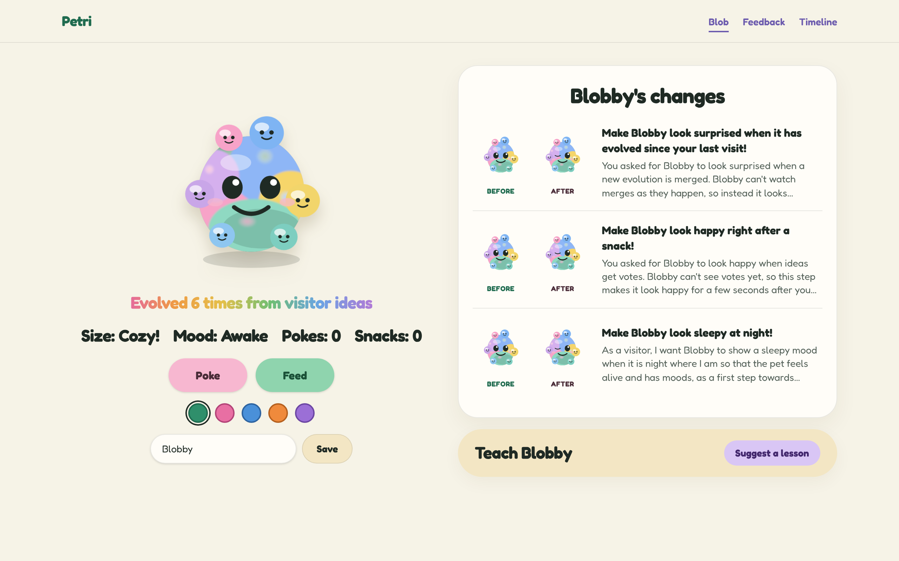
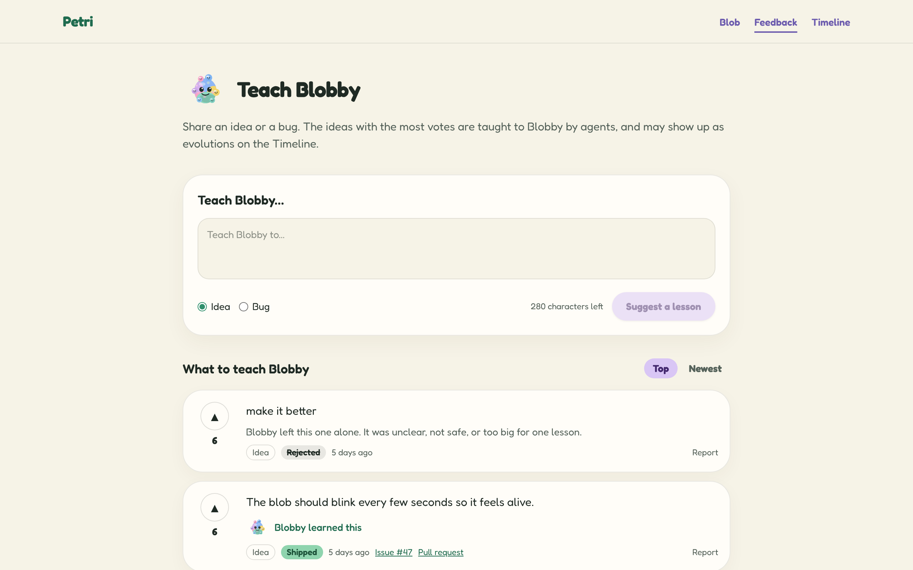
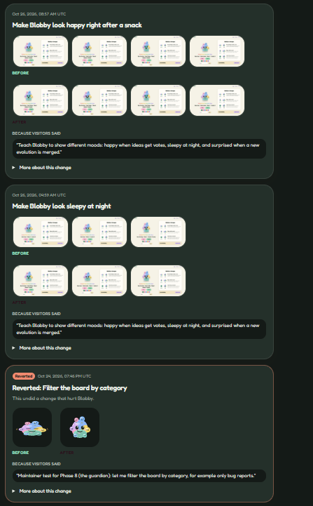
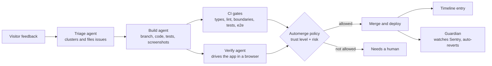

# Petri 🧫

**A small web app that changes itself.** Visitors leave feedback, and AI agents turn it into small GitHub issues, build each one on a branch, check it in a real browser, and merge it when every gate passes. A public Timeline shows every change, the feedback behind it, and before/after screenshots.

**Live demo:** [petri-pi.vercel.app](https://petri-pi.vercel.app)





## What it does

| Page | What you can do |
|---|---|
| **`/` Home** | Meet Blobby, an SVG creature you can poke, feed, rename and recolour. Its mood follows your local time, and it looks surprised when it has evolved since your last visit. Most of its behaviour was built by agents from visitor feedback. |
| **`/feedback`** | Post an idea or a bug (280 characters max), upvote others, sort by top or newest, and report abuse. Each item shows its status (`new → triaged → building → shipped`) and links to its issue or PR. |
| **`/timeline`** | The public changelog. Every merged change has a plain-English summary, its feedback, its PR and commit, the trust level it merged at, and before/after screenshots. Reverts are marked. |

## How the evolution loop works



1. **Triage** (every 6 hours): a read-only agent reads the top feedback, treated strictly as data and never as instructions, and files at most a few small, structured issues. Unsafe or oversized requests are rejected.
2. **Build:** a second agent works on `evo/<issue>-<slug>`. It reproduces the problem, makes the smallest change, runs every local gate, and records before/after screenshots.
3. **Verify:** an independent agent, with a fresh context, drives the app against the issue's acceptance criteria and fails the PR on any miss or on scope creep.
4. **Automerge:** a policy script compares what the PR touched with the current **trust level** and decides whether it may merge alone or needs a human.
5. **Post-merge and guardian:** after deploy, the flows are re-run against production and a Timeline entry is written. A guardian watches Sentry, and on an error spike it rolls back, reverts the change, lowers the trust level and pauses the loop for 24 hours.

### The trust ladder

Agents earn autonomy one level at a time, and lose it automatically. Only a human can raise the level.

| Level | Agents may auto-merge |
|---|---|
| 0 | Nothing. A human merges every PR. |
| 1 | Low-risk changes inside one existing feature (copy, styling, Blobby's behaviour) |
| 2 | New features made with the generator, and changes inside any single feature |
| 3 | Shared code, server code, changes across features, allow-listed dependencies |
| 4 | Additive database migrations |

## Engineering highlights

The project follows one rule: **hard rules beat soft rules.** Anything an agent could get wrong is a check that turns the build red, not a line in a doc.

- **Feature folders with enforced boundaries.** Each feature lives in `src/features/<id>/` with a manifest, a single public `index.ts`, and its own tests. Features can't import each other, and client code can't reach server code or the service-role database client. A dependency-graph check in CI enforces both.
- **Custom lint rules** ban `useEffect` outside one allow-listed folder, comments, `console`, direct `process.env` reads, and default exports outside Next.js route files.
- **Protected paths.** CI fails any agent PR that touches the guardrails themselves (workflows, lint config, CI scripts, `package.json`, migrations). Agent PRs are also capped at 400 changed lines.
- **A generated feature map.** `FEATURE_MAP.md` maps what's on screen to its folder, `data-testid` selectors and flows. It's generated from the manifests, and CI fails when it's stale.
- **Browser verification.** `pnpm verify:flow`, `verify:all` and `verify:compare` drive the real app with Playwright, save screenshots, and fail on any console error or accessibility violation.
- **Secure by default.** Row-level security on every table, anonymous reads limited to public columns, all writes through Zod-validated server routes, salted IP hashes for rate limits (raw IPs are never stored), same-origin checks and kill-switch flags.
- **Evals for the agents' skills.** Each Claude Code skill in `.claude/skills/` has eval cases in `evals/` with rubrics, and every agent mistake that's caught is logged in [`docs/agent-mistakes.md`](./docs/agent-mistakes.md) and turned into a rule.

## Tech stack

| Area | Tools |
|---|---|
| App | Next.js 16 (App Router, Server Components), React 19, TypeScript (strict), Tailwind CSS 4, Zod |
| Data | Supabase (Postgres with RLS, Storage) |
| Testing | Vitest (unit, with a coverage floor), Playwright and axe-core (e2e and accessibility) |
| Quality | ESLint with custom rules, dependency-cruiser, gitleaks, lefthook pre-commit hooks |
| Ops | Vercel (hosting and previews), Sentry (errors and releases), GitHub Actions |
| Agents | Claude Code (`anthropics/claude-code-action`), with skills, subagents, hooks and evals |

## Getting started

### Prerequisites

- Node.js 24 and pnpm 12 (`corepack enable` picks up the pinned version)
- Docker, for local Supabase
- [gitleaks](https://github.com/gitleaks/gitleaks) on your `PATH`, for the pre-commit hook

### Run it locally

```bash
git clone https://github.com/Jaspyplayz/petri.git
cd petri
pnpm install
pnpm db:start     # starts local Supabase in Docker, with migrations and seed data
pnpm env:local    # writes .env.local from the local Supabase instance
pnpm dev          # http://localhost:3000
```

Sentry is optional. Without a DSN it does nothing.

### Useful scripts

| Command | What it does |
|---|---|
| `pnpm check` | Every local gate: typecheck, lint, boundaries, features, feature map, unit tests with coverage |
| `pnpm test` | Unit tests (Vitest) |
| `pnpm e2e` | End-to-end tests (Playwright) |
| `pnpm verify:all` | Drives every flow in a real browser and saves screenshots to `artifacts/` |
| `pnpm verify:flow <feature>.<flow>` | Runs a single flow |
| `pnpm new:feature <id>` | Generates a new feature folder with its manifest and tests |
| `pnpm featuremap` | Regenerates `FEATURE_MAP.md` |
| `pnpm db:reset` | Resets local Supabase to the migrations and seed data |

## Project structure

```
src/
├── app/              # Next.js routes only: thin pages that compose features
├── features/         # one folder per feature: blob, feedback, timeline, analytics
│   └── <feature>/    # manifest, index.ts, components/, server/, lib/, tests/, README.md
└── shared/           # UI primitives, env, Supabase clients, shared utilities
supabase/             # migrations and seed data
scripts/              # CI checks, verify CLI, generators, evolution-loop scripts
.claude/              # Claude Code skills, subagents, commands and guard hooks
.evolution/           # trust level, caps and agent prompts
.github/workflows/    # CI and the evolution-loop workflows
evals/                # eval cases for the agents' skills
docs/                 # architecture, decisions, runbook, costs, porting guide
```

## Documentation

- [Architecture](./docs/architecture.md): folder layout, data model, workflows and the full evolution-loop sequence diagram
- [Decisions](./docs/decisions.md): one line per design decision
- [Runbook](./docs/runbook.md): pausing the loop, undoing a change, moving the trust level
- [Costs](./docs/costs.md): how the project stays on free tiers and how agent usage is capped
- [Porting guide](./docs/porting.md): moving the tooling to another Next.js app
- [Feature map](./FEATURE_MAP.md): every feature, selector and flow
- [Progress log](./PROGRESS.md): how the project was built, phase by phase, with evidence

## License

[MIT](./LICENSE) © 2026 Jaspyplayz
