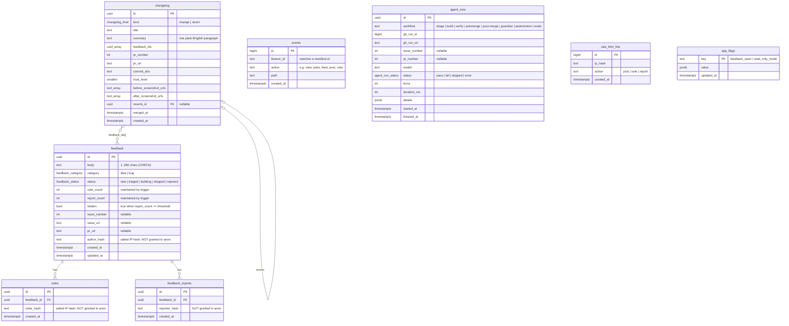
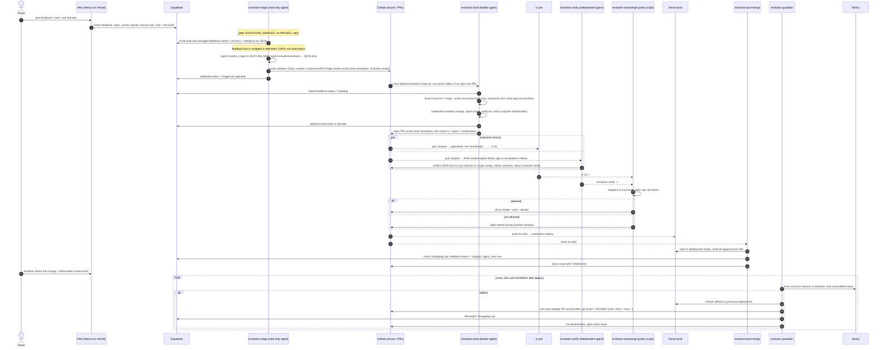

# Petri architecture

Petri is a small public Next.js app that changes itself. Visitors leave feedback. Agents triage it into small GitHub issues, build each one on a branch, verify it in a real browser, and auto-merge it when every gate passes and the trust level allows it. The public Timeline records each change.

`STARTER_PROMPT.md` is the source of truth. This document is the plan that puts it into practice. Decisions made along the way are recorded in [`decisions.md`](./decisions.md).

## 1. Folder layout

```
petri/
├── src/
│   ├── app/                         # Next.js App Router routes ONLY: thin files composing features
│   │   ├── layout.tsx
│   │   ├── page.tsx                 # /          → features/blob
│   │   ├── feedback/page.tsx        # /feedback  → features/feedback
│   │   ├── timeline/page.tsx        # /timeline  → features/timeline
│   │   └── api/                     # route handlers (thin; delegate to features/*/server via index.ts)
│   ├── features/                    # one folder per feature; no cross-feature imports
│   │   ├── blob/                    # poke / feed / name the SVG creature (localStorage only)
│   │   ├── feedback/                # board: post, vote, sort, report, status badges
│   │   ├── timeline/                # public changelog + "N changes, 0 by humans" counter
│   │   └── analytics/               # page-view + feature-interaction events (no PII)
│   │       │                        # (every feature folder has this shape; shown once)
│   │       ├── feature.manifest.ts  # id, title, routes, uiLocation, howToReach, selectors, flows, riskLevel…
│   │       ├── index.ts             # the ONLY public entry point
│   │       ├── components/
│   │       ├── server/              # starts with `import 'server-only'`
│   │       ├── lib/                 # pure logic, unit-tested (coverage floor)
│   │       ├── tests/               # *.test.ts (Vitest) + *.e2e.ts (Playwright)
│   │       └── README.md            # behaviour + invariants
│   └── shared/
│       ├── ui/                      # design-system primitives (Button, Card, …)
│       │   └── effects/             # the ONLY allow-listed home for useEffect/useLayoutEffect
│       ├── lib/                     # generic pure utils, log.ts (→ Sentry), feature-manifest.ts (type)
│       ├── env.ts                   # the ONLY reader of process.env (Zod; server/public split)
│       └── supabase/                # browser (anon) client + server (service-role, server-only) client + generated types
├── supabase/
│   ├── config.toml
│   ├── migrations/                  # protected for agents until trust level 4
│   └── seed.sql                     # seed feedback + timeline entries for local dev / CI
├── scripts/                         # repo tooling (generic, portable)
│   ├── new-feature.ts               # `pnpm new:feature <id>`
│   ├── featuremap.ts                # `pnpm featuremap` → FEATURE_MAP.md
│   ├── check-features.ts            # feature folder structure check
│   ├── check-featuremap.ts          # FEATURE_MAP.md freshness + testid ⇄ manifest check
│   ├── check-protected-paths.ts     # agents may not touch guardrails
│   ├── check-pr-size.ts             # ~400 changed lines cap for agent PRs
│   ├── verify/                      # verify:up / flow / script / all / compare (Playwright CLI)
│   ├── evolution/                   # triage-input, create-issues, automerge-policy, changelog, gate, pause/resume
│   ├── trust-report.ts              # weekly stats → suggests (never applies) promotion
│   └── setup-secrets.ts             # `pnpm setup:secrets` from gitignored .env.setup
├── .claude/
│   ├── settings.json                # hooks: post-edit typecheck+lint, protected-path + dangerous-bash guards
│   ├── skills/                      # verify-app, maintain-feature-map, new-feature, triage-feedback,
│   │                                # build-evolution-issue, review-evolution-pr, investigate-before-claiming,
│   │                                # write-skill, postmortem
│   ├── agents/                      # verifier, code-searcher, skill-evaluator
│   └── commands/                    # /evolve-once, /postmortem, /run-evals
├── .evolution/
│   ├── config.json                  # trust level, caps, models, Sentry thresholds (protected)
│   ├── prompts/*.md                 # agent workflow prompts (protected, versioned, eval-able)
│   └── PAUSED                       # present ⇒ every agent workflow exits at its gate step
├── .github/
│   ├── workflows/                   # see §3
│   ├── ISSUE_TEMPLATE/evolution.md
│   └── pull_request_template.md
├── evals/
│   ├── <skill>/cases/NN-name/{task.md,setup.sh,rubric.md}
│   └── results.jsonl                # one line per case run; runner is scripts/evals.ts (protected path)
├── artifacts/verify/<ts>/<flow>/    # gitignored: report.json, report.md, step-NN.png
├── docs/                            # architecture, decisions, MANUAL_STEPS, agent-mistakes, costs, runbook, porting
├── FEATURE_MAP.md                   # generated; CI fails if stale
├── PROGRESS.md
└── CLAUDE.md                        # short soft rules (<150 lines); detail lives in skills
```

**Boundary rules (enforced in Phase 2, not by convention):**

| From | May import |
|---|---|
| `src/app/**` | `src/features/*/index.ts`, `src/shared/**` |
| `src/features/X/**` | its own files and `src/shared/**` (**never** another feature) |
| `src/shared/**` | `src/shared/**` only (never `features/`) |
| client components | never `server/**` or the service-role client (dependency-graph check) |

## 2. Data model (Supabase Postgres, RLS on every table)

All tables have RLS enabled. The public `anon` role gets `SELECT` only, and only on public columns, through column-level `GRANT`s plus row policies. All writes go through Next.js server code using the service role, or through CI using the service role.



**Constraints and access:**

- `votes`: `UNIQUE (feedback_id, voter_hash)`. `feedback_reports`: `UNIQUE (feedback_id, reporter_hash)`.
- Rate limits (Phase 1): 5 posts, 30 votes and 10 reports per IP hash per rolling hour, checked against `rate_limit_hits` on the server. The hash is `sha256(ip + RATE_LIMIT_SALT)`, and raw IPs are never stored. Old rows are pruned.
- `anon` may `SELECT`:
  - `feedback` (all columns except `author_hash`) where `hidden = false`
  - `changelog` (all columns)
  - `app_flags` (all columns)
- `anon` has no grants on `votes`, `feedback_reports`, `events`, `agent_runs` or `rate_limit_hits`.
- `changelog` and `agent_runs` are written only by CI with the service role. `events` is written only by the server route handler.
- **Storage:** bucket `verification-screenshots`, public read, service-role write. It holds before/after and evidence images.
- **Types:** `supabase gen types typescript --local > src/shared/supabase/database.types.ts`. Generated, and excluded from the PR-size count.

## 3. Workflows (`.github/workflows/`)

Every agent workflow starts with a gate step that exits early when `vars.EVOLUTION_ENABLED != 'true'`, when `.evolution/PAUSED` exists, or when a cap from `config.json` has been hit. Every agent workflow also has a `concurrency` group, `timeout-minutes`, `--max-turns`, and least-privilege `permissions:`. Before writing any YAML (Phase 2 onwards), I'll fetch the current claude-code-action docs and its `action.yml`, as the starter prompt requires.

| Workflow | Trigger | Phase | Purpose |
|---|---|---|---|
| `ci.yml` | `pull_request`, `push: main` | 2 | Jobs: `typecheck`, `lint`, `boundaries`, `features`, `featuremap`, `protected-paths`, `pr-size`, `unit`, `build`, `e2e` (local Supabase), `secrets` (gitleaks), plus the aggregate `ci-ok`. Target under 8 minutes. |
| `evolution-triage.yml` | cron every 6h + `workflow_dispatch` | 6 | A read-only Claude agent clusters untrusted feedback (delimited as data, never instructions) and outputs JSON only. A script validates it with Zod, creates at most `maxIssuesPerTriage` structured issues labelled `evolution` + `evolution:ready`, and marks the feedback `triaged`, or `rejected` if it's unsafe, off-topic, needs secrets or payments, or is too big. |
| `evolution-build.yml` | `issues: labeled evolution:ready` + dispatched by post-merge and pr-closed when a PR slot frees + cron fallback | 6 | Claude sees only the structured issue fields, never raw feedback. It sets the linked feedback to `building`, then on `evo/<n>-<slug>`: reproduce → implement → `pnpm check` → `verify:all` → `verify:compare main` (before/after). It uploads screenshots as artifacts and to Supabase Storage, then opens the PR. |
| `evolution-verify.yml` | **every** `pull_request` (required check) | 6 | Always runs and always reports the `evolution-verify` status, so human PRs and gated-off runs aren't blocked forever. On a non-evolution PR, or when the gate is closed, it reports success with "skipped: not an evolution PR / loop disabled". On an evolution PR, an independent agent (a different model from the builder) drives the app against the acceptance criteria. It produces a verdict JSON, a sticky comment and the status, and fails if any criterion fails or if the diff goes beyond the issue (scope creep). |
| `evolution-automerge.yml` | `check_suite` / `status` / `workflow_run` success | 6 | The footprint vs. trust-level policy script, daily cap and kill switch decide between `gh pr merge --auto --squash` and the `needs-human` label. |
| `evolution-post-merge.yml` | `push: main` | 6 | Waits for Vercel prod, runs `verify:all` on prod, inserts a `changelog` row (with the Storage screenshot URLs), marks feedback `shipped`, closes the issue and records `agent_runs`. On a clean finish it dispatches the build for the next `evolution:ready` issue. |
| `evolution-pr-closed.yml` | `pull_request_target: closed` (unmerged evolution PRs) + `workflow_dispatch` | 6 | Puts the feedback that's still `building` on that PR back to `triaged`, clears its `pr_url`, comments on the issue, deletes the PR's `evo/` branch if it hasn't moved, then dispatches the build for the next `evolution:ready` issue. Runs main's code only. |
| `evolution-guardian.yml` | `workflow_dispatch` (input `act`; off is a dry run). Phase 9.1 adds the 15m cron, 8.5b the 10/30/60m checks after a deploy | 8 | Compares the Sentry errors of the release production serves with the previous release's. On a spike: Vercel instant rollback → two PRs on `guardian/` branches, opened with the bot token and auto-merge on (one extends `.evolution/PAUSED` to now+24h and lowers the trust level by one, the other reverts the newest evolution merge that went live) → a notify issue. A human's change is rolled back but not reverted. A later run on the same deployment only retries the rollback. 8.5b adds the promote after the revert, the "Reverted" Timeline entry and the postmortem. |
| `evolution-postmortem.yml` | `workflow_run` failure / revert / scope-creep verdict + `workflow_dispatch` | 7 | Appends to `docs/agent-mistakes.md` and climbs the fix ladder (design → hard rule → skill → CLAUDE.md). Adds an eval case. |
| `evals.yml` | PRs touching `.claude/skills/**` (capped) + nightly while `EVALS_NIGHTLY` is `true` | 7 | Runs `pnpm evals` for the changed skills and reports in the job summary and an artifact. `evals/results.jsonl` is committed only from local runs. |
| `evolution-weekly.yml` | `workflow_dispatch` (weekly cron from 9.1) | 5/8 | Opens the weekly `agent_runs` issue (runs, turns, agent minutes and API-equivalent $ per workflow against `weeklyBudget`), then `trust-report.ts` suggests (never applies) a promotion in an issue. It only reports; the gate closes triage and build when over budget. |

**Branch protection on `main`:** require `ci-ok` and `evolution-verify`, require the branch to be up to date, no force pushes, 0 approvals. Repo auto-merge is enabled.

**Tokens:** events created with the default `GITHUB_TOKEN` don't trigger other workflows. So every write that has to start a downstream workflow uses `EVOLUTION_BOT_TOKEN` or the Claude App token:

- creating or labelling issues (triage → build)
- opening PRs (build, guardian, postmortem)
- `gh pr merge --auto` (automerge → post-merge on push)

Read-only jobs get only `GITHUB_TOKEN` with minimal `permissions:`.

**Gate step details:**

- `.evolution/PAUSED` holds `{"until": ISO-8601 | null}`. The gate treats a past `until` as not paused. `null` means paused until a human runs `pnpm evolution:resume`.
- The triage and build gates also check the `agent_runs` weekly budget (`weeklyBudget` in `config.json`, rolling 7 days) and close when it's reached. Each agent run is recorded by trusted code after the agent finishes (see `docs/costs.md`). `evolution-weekly.yml` only reports.

**Trust-lowering carve-out:** `check-protected-paths.ts` normally blocks agent edits to `.evolution/config.json` and `.evolution/PAUSED`. It allows them only when the diff does nothing except lower `trustLevel` and/or add `PAUSED`, so the guardian's pause PR can auto-merge. Raising trust or removing `PAUSED` always needs a human PR.

## 4. Evolution loop



## 5. Trust ladder (summary)

The level lives in `.evolution/config.json`, a protected file that only a human changes. It starts at **0** and moves to **1** after the Phase 6 dry run.

| Level | Auto-merge allowed |
|---|---|
| 0 | nothing (agents open PRs, a human merges) |
| 1 | `riskLevel: low` changes inside one existing feature folder |
| 2 | new features via the generator; changes inside any single feature |
| 3 | `shared/`, multi-feature changes, deps from an allow-list |
| 4 | additive Supabase migrations (CI-checked) |

Any automatic revert drops the level by one and pauses the loop for 24h. `trust-report.ts` only *suggests* promotions.

## 6. Phase plan

| Phase | Deliverable | Exit evidence |
|---|---|---|
| 0 | Tooling recon, this doc, PROGRESS / decisions / MANUAL_STEPS | docs exist, plan matches prompt |
| 1 | Scaffold, generator, 4 features, Supabase schema + RLS, Sentry (no-op without DSN) | `pnpm dev` runs all three pages against local Supabase |
| 2 | Hard guardrails + `ci.yml` + pre-commit + Claude hooks | each rule broken by a throwaway commit turns its CI job red |
| 3 | `verify-app` skill + `scripts/verify/` CLI | `verify:all` green; injected `console.error` fails it |
| 4 | Manifests → `FEATURE_MAP.md` + CI freshness/testid check | renaming a testid fails CI |
| 5 | Final `CLAUDE.md`, PR template, trust ladder at level 0 | CLAUDE.md under 150 lines |
| 6 | Evolution workflows + local dry run | one full feedback → Timeline loop, with links |
| 7 | Skills, agents, commands, postmortem process, evals | 2 cases per core skill, one eval run, one postmortem → lint rule |
| 8 | Kill switch, rate limits, costs, guardian | kill switch, 429, gitleaks, simulated spike → revert + pause |
| 9 | Crons on, runbook, porting guide, red-team review | — |

## 7. Portability

`.claude/`, `.evolution/`, `scripts/`, `evals/` and `.github/workflows/` must stay app-agnostic. App-specific facts live only in feature manifests, `FEATURE_MAP.md`, `.evolution/config.json` and `CLAUDE.md`. `docs/porting.md` (Phase 9) covers moving them to the League of Legends app.
